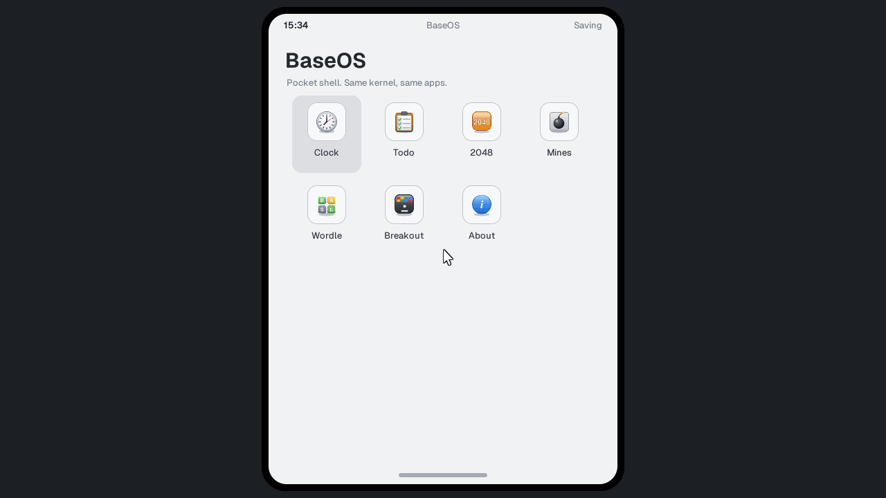

# Architecture: kernel, layers and shells

BaseOS is split so the user interface can be replaced without touching the
kernel. The kernel owns the machine. A shell owns everything a person sees.
Exactly one shell is linked into each image, and the kernel talks to it through
one small table in `src/kernel/shell.h`.

Two shells exist today:

| Shell | Build | What it is |
| --- | --- | --- |
| `desktop` | `make` | The full desktop: windows, taskbar, launcher, every app |
| `pocket` | `make pocket` | A phone-style shell: portrait screen, home grid, one app at a time |

Both run on the same kernel objects, the same app components and the same disk
format. A disk written under one shell boots under the other
(`tools/pocket_test.py` checks this).



## Layers

Each layer is a directory under `src/`. A layer may use itself and the layers
above it in this table, never a layer below it.

| Layer | Directory | Owns |
| --- | --- | --- |
| Core | `src/kernel/`, `src/lib/` | Boot, memory, storage, devices, input stream, framebuffer and drawing primitives, processes (BEX and ELF, see PLATFORM_V2.md), network, audio, downloads; pure models and codecs (sheet, writer, media, BASIC) |
| UI kit | `src/ui/` | Theme tokens and metrics (`ui_theme`, `TK_*`), the control kit, icon art and drawing, toolbar helpers |
| Apps | `src/apps/` | App components: model plus drawing and input handlers, with no knowledge of windows |
| Shell | `src/shell/<name>/` | Screens or windows, launching, input routing, app hosting, preferences, boot UI |

Two rules follow from the table. The core never includes `ui/`, `apps/` or
`shell/` headers and never calls their code. A shell never includes another
shell. `tests/test_architecture.py` enforces both on every `#include`, and,
after `make`, checks the built objects: the core, core plus UI, and core plus UI
plus apps must each link without any symbol from a later layer, except the
`baseos_shell` contract itself. It also links the kernel with a stub shell.

Includes name their layer (`#include "kernel/fs.h"`); the build passes
`-Isrc`. Objects stay flat in the output directory.

## The shell contract

```c
typedef struct {
    const char *name;
    void (*prepare)(void);  /* storage mounted, input not live yet */
    void (*start)(void);    /* input live: draw the first frame */
    int  (*turn)(void);     /* one cooperative frame; nonzero while busy */
} Shell;
extern const Shell baseos_shell;
```

`kmain` in `src/kernel/kernel.c` runs the sequence:

1. Validate memory, configure the disk, initialize video, owned pages, audio,
   network and the filesystem, and mount the disk.
2. Call `baseos_shell.prepare()`. The shell loads its preferences, may change
   the display mode, and seeds first-boot files.
3. Size the pointer to the (possibly new) mode, initialize the PS/2 mouse and
   start accepting input.
4. Call `baseos_shell.start()`.
5. Loop forever: `kernel_storage_poll()`, `kernel_services_poll()`, then
   `baseos_shell.turn()`. When the shell reports idle and no storage or input
   work is pending, the CPU halts until the next interrupt.

## What the kernel offers a shell

`src/kernel/kernel.h` is the entry point. It covers serial logging
(`kprint_debug` and friends), the ordered input stream (`device_input`,
`input_pop`, `drain_8042`), `kernel_pointer_ready()`, `kernel_power_off()`, and
kernel events. Background work reports changes as events instead of calling
shell code:

| Event | Raised when |
| --- | --- |
| `KERNEL_EVENT_STORAGE` | The storage status text changed during a sync step |
| `KERNEL_EVENT_DOWNLOADS` | A background download changed observable state or files |

A shell calls `kernel_events_take(mask)` in its turn and repaints what it
needs. The remaining service headers (`kernel/fs.h`, `kernel/gfx.h`,
`kernel/rtc.h`, `kernel/program.h` and so on) are public to every layer above
the core.

Hooks run the other way where the core needs a shell decision. The terminal's
program I/O uses `term_set_program_io`, native windows use
`native_ui_init(&hooks)`, and the theme palette bands are installed with
`ui_theme_install()` from `ui/theme.c`. A shell that never sets a hook gets
a safe default.

## Memory a shell may use

Fixed regions are defined in `src/kernel/layout.h`. Kernel services own their
regions (filesystem, page allocator, processes, framebuffer and back buffer).
The editor arena at `EDITOR_BASE` belongs to whichever shell is linked: the
desktop keeps its window state and edit buffers there, and Pocket uses it as
first-boot scratch. The kernel image, including BSS, must stay under the
budget the linker script checks.

First-boot files (sample documents, bundled programs, the chime) are created by
`provision_system_files(scratch, bytes)` in `src/lib/provision.c`. Each shell
calls it from `prepare` with scratch memory it owns, so every shell sees the
same starting disk.

## Adding a shell

1. Create `src/shell/<name>/` with one or more `.c` files.
2. Include only `kernel/`, `lib/`, `ui/` and `apps/` headers.
3. Define `const Shell baseos_shell = {"<name>", prepare, start, turn};`.
4. In `prepare`, call `ui_theme_install(style, accent, desktop)`, which sets the
   palette bands, the `ui_theme` metrics and the `app_*` tokens apps draw
   with, and call `provision_system_files`.
5. In `turn`, pop input from `device_input`, take kernel events, draw, and
   return nonzero while anything is animating or waiting to be drawn.
6. Build with `make BASEOS_SHELL=<name>`. Output goes to `build/<name>/`, so it
   never mixes with the desktop objects in `build/`. Run it with
   `make BASEOS_SHELL=<name> run`.

`src/shell/pocket/pocket.c` is a complete example in about 500 lines. It reuses
Clock, 2048, Mines, Wordle and Breakout unchanged, draws its own screen for the
Todo model, and has an About screen with a shutdown button.

## Testing

- `make test` runs the host suite, including `tests/test_architecture.py`.
- `python3 tools/pocket_test.py build/pocket build` boots Pocket in QEMU,
  drives it with keys and clicks, saves a todo, shuts down, then boots the
  desktop kernel on the same disk and checks the item is there. Run `make` and
  `make pocket` first.
- The desktop QEMU suite (`tools/regression.py`) is unchanged.
